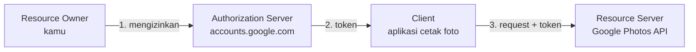
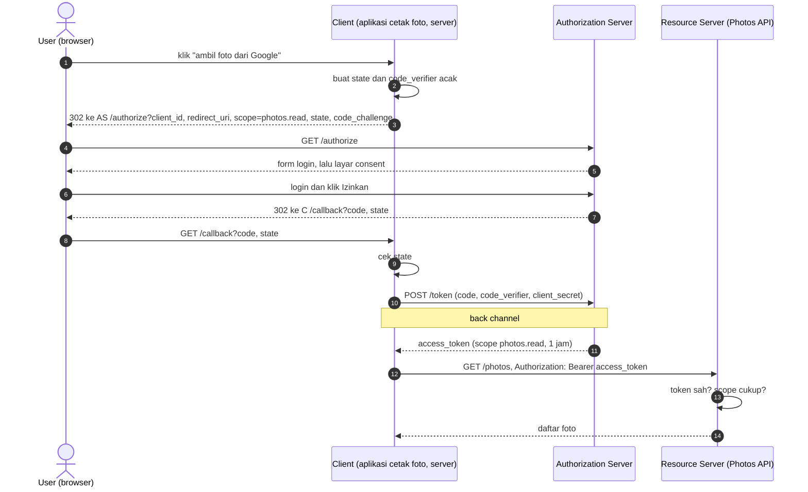

# OAuth 2.0 dan OpenID Connect

Catatan belajar. Bagian 1 sampai 4 membahas OAuth saja, karena OIDC tidak bisa dipahami tanpa OAuth. OIDC baru masuk di bagian 5.

Ringkasan dalam dua kalimat:

- **OAuth 2.0** menjawab: *"boleh nggak aplikasi ini mengakses data user?"* (**otorisasi**)
- **OpenID Connect (OIDC)** menjawab: *"user ini siapa?"* (**autentikasi**), dibangun di atas OAuth.

---

## 1. Masalah yang diselesaikan OAuth

Tahun 2006-an, kalau aplikasi cetak foto ingin mengambil foto dari Google Photos milikmu, caranya begini:

```
Aplikasi cetak foto: "Masukkan email dan password Google kamu."
```

Ini buruk karena:

1. Aplikasi itu memegang **password asli**, jadi bisa melakukan **apa saja**: baca email, hapus file, ganti password.
2. Kamu tidak bisa mencabut akses aplikasi itu saja. Satu-satunya cara adalah ganti password, dan semua aplikasi lain ikut putus.
3. Kalau aplikasi itu kena hack, password Google kamu ikut bocor.

OAuth menggantinya dengan **izin terbatas**:

```
Aplikasi cetak foto: "Login di Google dulu ya."
Google:              "Aplikasi cetak foto minta izin MEMBACA FOTO kamu. Izinkan?"
Kamu:                "Izinkan."
Google → aplikasi:   sebuah token yang HANYA bisa membaca foto, dan berlaku 1 jam.
```

Aplikasi tidak pernah melihat password. Izinnya terbatas (hanya baca foto), sementara (1 jam), dan bisa dicabut kapan saja tanpa mengganti password.

**Analogi: kunci valet.** Beberapa mobil punya kunci khusus untuk petugas parkir. Kunci itu bisa menyalakan mesin, tapi tidak bisa membuka bagasi atau laci. Kamu meminjamkan kemampuan terbatas, bukan kunci utama.

Istilah resminya: OAuth adalah kerangka **delegated authorization**, yaitu memberi wewenang terbatas kepada pihak lain atas nama kamu.

---

## 2. Terminologi OAuth 2.0

### 2.1 Empat peran (roles)

Ini bagian terpenting. Hampir semua kebingungan soal OAuth hilang kalau empat peran ini jelas.

| Peran | Artinya | Di contoh cetak foto |
|---|---|---|
| **Resource Owner** | Pemilik data. Biasanya manusia, si user. | Kamu |
| **Client** | Aplikasi yang **ingin mengakses** data user. Bukan "client" dalam arti browser. | Aplikasi cetak foto |
| **Authorization Server (AS)** | Server yang mengecek siapa user, meminta persetujuan, lalu **menerbitkan token**. | `accounts.google.com` |
| **Resource Server (RS)** | Server yang **menyimpan data** dan menerima token sebagai izin. Biasanya API. | `photoslibrary.googleapis.com` |



Authorization Server dan Resource Server sering milik perusahaan yang sama (keduanya Google), tapi perannya berbeda. Yang satu **menerbitkan** izin, yang lain **menerima** izin.

Kata "client" di OAuth sering membingungkan. Di sini artinya **aplikasi pihak ketiga yang meminta akses**, dan biasanya justru sebuah **server**, bukan browser.

### 2.2 Istilah lain

| Istilah | Artinya |
|---|---|
| **Access token** | String yang dibawa Client ke Resource Server sebagai bukti izin. Ibarat tiket masuk. |
| **Bearer token** | Jenis access token yang paling umum: *siapa pun yang memegangnya boleh memakainya*, tanpa bukti tambahan. Seperti uang tunai, kalau hilang bisa dipakai orang lain. Karena itu harus pendek umurnya dan tidak boleh bocor. Dikirim lewat header `Authorization: Bearer <token>` (RFC 6750). |
| **Refresh token** | Token berumur panjang untuk meminta access token baru tanpa user login ulang. Hanya dikirim ke Authorization Server, tidak pernah ke Resource Server. |
| **Scope** | Daftar izin yang diminta, misalnya `photos.read` atau `email`. User melihat daftar ini di layar persetujuan. |
| **Consent** | Layar "Aplikasi X minta izin untuk Y. Izinkan?" |
| **Authorization grant** | Bukti persetujuan user yang ditukar Client menjadi token. Ada beberapa jenis (bagian 3). |
| **Authorization code** | Jenis grant yang paling umum: kode sekali pakai, berumur pendek, dikirim lewat URL. Bukan token, hanya bisa **ditukar** menjadi token. |
| **`client_id`** | Nama Client yang terdaftar di Authorization Server. Publik, bukan rahasia. |
| **`client_secret`** | Password milik Client (bukan milik user). Hanya dimiliki client yang bisa menyimpan rahasia. |
| **Redirect URI** | Alamat Client tempat user dikembalikan setelah login. Harus terdaftar dan dicocokkan **persis**. Kalau tidak, penyerang bisa mengalihkan code ke servernya sendiri. |
| **Authorization endpoint** | URL di Authorization Server yang dibuka **browser** user. Di dul-auth: `/authorize`. |
| **Token endpoint** | URL di Authorization Server yang dipanggil **server Client** untuk menukar code menjadi token. Di dul-auth: `/oauth/token`. |
| **`state`** | String acak dari Client, dikembalikan apa adanya di callback. Mencegah CSRF: memastikan callback berasal dari login yang dimulai browser ini. |
| **PKCE** | *Proof Key for Code Exchange* (RFC 7636), dibaca "pixie". Client membuat rahasia `code_verifier`, mengirim hash-nya (`code_challenge`) di awal, lalu mengirim rahasianya saat menukar code. Code curian jadi tidak bisa ditukar. |

### 2.3 Jenis client

| Jenis | Bisa simpan rahasia? | Contoh | Cara membuktikan diri di token endpoint |
|---|---|---|---|
| **Confidential client** | Ya, kodenya jalan di server | backend SvelteKit, Go, Rails | `client_secret` (+ PKCE) |
| **Public client** | Tidak, kodenya ada di perangkat user | SPA murni di browser, aplikasi mobile | hanya PKCE |

Aplikasi mobile bisa dibongkar, dan JavaScript di browser bisa dibaca siapa saja. Rahasia yang ditaruh di sana bukan rahasia lagi.

### 2.4 Front channel dan back channel

Dua jalur komunikasi ini menjelaskan kenapa ada code **dan** token, bukan langsung token.

| Jalur | Lewat mana | Aman? | Dipakai untuk |
|---|---|---|---|
| **Front channel** | Browser user, lewat redirect dan URL | Kurang. URL bisa tercatat di history, log server, header `Referer`, extension | authorization request, authorization code |
| **Back channel** | Langsung server ke server lewat HTTPS | Ya, browser tidak terlibat | menukar code menjadi token |

Karena itu Authorization Server **tidak mengirim token lewat browser**. Yang lewat browser hanya code: sekali pakai, umur 60 detik, dan tidak berguna tanpa `code_verifier` (dan `client_secret` untuk confidential client). Token baru keluar di back channel.

---

## 3. Grant types (cara mendapatkan token)

| Grant | Untuk | Status |
|---|---|---|
| **Authorization Code + PKCE** | Aplikasi yang punya user manusia: web, mobile, SPA | **Standar sekarang.** Dipakai dul-auth. |
| **Client Credentials** | Mesin ke mesin, tanpa user. Misalnya cron job memanggil API. | Dipakai |
| **Device Code** | Perangkat tanpa keyboard yang nyaman: smart TV, CLI. "Buka link ini di HP, masukkan kode ABCD." | Dipakai |
| **Refresh Token** | Memperpanjang akses tanpa login ulang | Dipakai |
| ~~Implicit~~ | Dulu untuk SPA. Token langsung dikirim lewat URL (front channel). | **Dihapus di OAuth 2.1.** Token bocor lewat URL. |
| ~~Resource Owner Password~~ | Client menerima password user langsung | **Dihapus di OAuth 2.1.** Kembali ke masalah di bagian 1. |

**OAuth 2.1** bukan protokol baru. Isinya OAuth 2.0 yang dirapikan dengan praktik aman yang sudah lama dianjurkan: PKCE wajib untuk semua client, implicit dan password grant dihapus, redirect URI dicocokkan persis.

### 3.1 Alur Authorization Code + PKCE (OAuth murni)

Contoh aplikasi cetak foto. Belum ada OIDC.



Perhatikan langkah 13 sampai 15: **tujuan akhir OAuth adalah memanggil API (Resource Server)**. Client memakai access token untuk mengambil data, bukan untuk mengetahui siapa user.

---

## 4. Yang OAuth tidak lakukan: memberi tahu siapa user

Access token adalah **tiket untuk Resource Server**, bukan kartu identitas untuk Client.

Dari sudut pandang Client, OAuth murni tidak menjamin apa pun soal identitas:

1. **Format access token tidak ditentukan.** Bisa JWT, bisa string acak. Client tidak seharusnya membaca isinya. Token itu ditujukan untuk Resource Server.
2. **Token tidak menyebut untuk client mana dia diterbitkan.** Ini membuka celah berikutnya.
3. **Serangan token substitution.** Banyak aplikasi dulu membuat "Login with X" dengan OAuth murni: terima access token, panggil `GET /me`, lalu anggap user itu sudah login. Masalahnya:

```
1. Penyerang membuat aplikasi kuis jahat. Kamu login ke kuis itu lewat X.
2. Aplikasi kuis sekarang memegang access token milikmu.
3. Penyerang mengirim token itu ke aplikasi lain, misalnya aplikasi bank, yang memakai "login pakai OAuth".
4. Bank memanggil GET /me dengan token itu, dapat "kamu", lalu memasukkan penyerang sebagai kamu.
```

Bank tidak bisa membedakan token yang memang diterbitkan untuk bank dari token yang diterbitkan untuk kuis. Inilah alasan kalimat yang sering dikutip: **"OAuth is not an authentication protocol."**

Setiap penyedia lalu membuat solusi sendiri (Facebook punya caranya, Google punya caranya), dan semuanya tidak kompatibel. OIDC lahir (2014) untuk menstandarkan solusi itu.

---

## 5. OpenID Connect (OIDC)

OIDC adalah **lapisan identitas di atas OAuth 2.0**. Alurnya sama persis (authorization code + PKCE, redirect yang sama, token endpoint yang sama). OIDC hanya **menambahkan** beberapa hal.

### 5.1 Yang ditambahkan OIDC

| Tambahan | Fungsinya |
|---|---|
| **Scope `openid`** | Penanda: "ini request OIDC, aku mau tahu siapa user". Tanpa scope ini, yang terjadi adalah OAuth biasa. |
| **ID token** | Inti OIDC. Sebuah JWT bertanda tangan yang berisi **siapa user**, **siapa yang menerbitkan**, dan **untuk client mana**. Ditujukan untuk Client, bukan untuk API. |
| **UserInfo endpoint** | API standar untuk mengambil profil user (`email`, `name`, ...) pakai access token. Di dul-auth: `/userinfo`. |
| **Standard claims** | Nama field yang disepakati: `sub`, `email`, `email_verified`, `name`, `picture`, ... Jadi tiap provider tidak memakai nama sendiri-sendiri. |
| **Discovery** | `/.well-known/openid-configuration`: dokumen JSON berisi semua endpoint dan kemampuan provider. Client cukup tahu URL issuer. |
| **JWKS** | Daftar kunci publik provider (di dul-auth: `/keys`) untuk memverifikasi tanda tangan ID token. |
| **`nonce`** | String acak dari Client yang dimasukkan ke dalam ID token. Mencegah ID token lama diputar ulang (replay). |

### 5.2 Peran di OIDC

OIDC memakai nama baru untuk peran yang sama:

| OAuth | OIDC | Di proyek kita |
|---|---|---|
| Resource Owner | **End-User** | kamu (admin) |
| Client | **Relying Party (RP)**, yaitu pihak yang *mengandalkan* provider untuk identitas | porto, nanti cuit |
| Authorization Server | **OpenID Provider (OP)** | dul-auth. Package library-nya pun bernama `op`. |
| Resource Server | (tetap) | belum ada. Porto tidak memanggil API milik dul-auth selain `/userinfo`. |

### 5.3 Kenapa ID token menutup celah di bagian 4

Isi ID token (payload JWT):

```json
{
  "iss": "https://auth.example.com",
  "sub": "8f14e45f-ceea-467a-9575-6f3b2c1d9e0a",
  "aud": "porto",
  "exp": 1764000000,
  "iat": 1763996400,
  "nonce": "n-0S6_WzA2Mj",
  "email": "admin@example.com"
}
```

| Claim | Artinya | Yang dicek Client |
|---|---|---|
| `iss` (issuer) | Siapa yang menerbitkan | Harus sama persis dengan issuer yang dipercaya |
| `sub` (subject) | ID user yang **tetap dan unik** di provider itu | Ini yang dipakai sebagai identitas, **bukan email** (email bisa berganti) |
| `aud` (audience) | **Untuk client mana** token ini | Harus berisi `client_id` milik sendiri. **Ini yang menggagalkan token substitution:** token untuk kuis punya `aud: kuis`, jadi bank menolaknya. |
| `exp`, `iat` | Kedaluwarsa dan waktu terbit | Belum lewat `exp` |
| `nonce` | Nilai acak dari Client | Sama dengan yang dikirim di awal (kalau dipakai) |

Ditambah **tanda tangan**: Client memverifikasi tanda tangan pakai kunci publik dari JWKS, mencocokkan `kid` di header JWT. Kalau satu huruf saja diubah, verifikasi gagal.

### 5.4 ID token vs access token

| | ID token | Access token |
|---|---|---|
| Ada di | OIDC | OAuth |
| Ditujukan untuk | **Client (RP)** | **Resource Server (API)** |
| Menjawab | "User ini siapa?" | "Pembawa token boleh melakukan apa?" |
| Format | **Selalu JWT** (ditetapkan spesifikasi) | Bebas. Di dul-auth kebetulan JWT. |
| Client membaca isinya? | Ya, wajib dan diverifikasi | Tidak seharusnya. Client hanya meneruskannya ke API. |
| Dikirim ke API? | **Jangan** | Ya, `Authorization: Bearer ...` |

Kesalahan umum: mengirim ID token ke API sebagai bearer token, atau membaca access token untuk mengetahui siapa user. Masing-masing token punya penerima sendiri.

### 5.5 Alur OIDC

Sama dengan alur di 3.1, dengan tiga perbedaan:

```diff
- scope=photos.read
+ scope=openid email

- AS-->>C: access_token
+ OP-->>RP: id_token + access_token

+ RP: verifikasi id_token (tanda tangan via JWKS, iss, aud, exp, nonce)
+ RP: user = sub → buat sesi login sendiri
```

Untuk versi lengkap dengan dul-auth dan porto, lihat PRD §6, §6.1, dan §6.2.

---

## 6. OAuth vs OIDC

| | OAuth 2.0 | OpenID Connect |
|---|---|---|
| Pertanyaan | Boleh mengakses apa? | Siapa user ini? |
| Kategori | Authorization (otorisasi) | Authentication (autentikasi) |
| Spesifikasi | RFC 6749 (IETF) | OpenID Connect Core 1.0 (OpenID Foundation), di atas OAuth 2.0 |
| Hasil utama | Access token | ID token (+ access token) |
| Format token | Tidak ditentukan | ID token selalu JWT |
| Penanda di request | scope bebas | scope wajib berisi `openid` |
| Profil user standar | Tidak ada | Standard claims + `/userinfo` |
| Konfigurasi otomatis | Tidak wajib (ada RFC 8414 terpisah) | Discovery + JWKS |
| Contoh nyata | "Izinkan aplikasi ini membaca repo GitHub kamu" | "Login with Google" |

Satu kalimat: **OIDC = OAuth 2.0 + ID token + aturan standar soal identitas.**

---

## 7. Kebingungan yang sering muncul

- **"Login with Google" itu OAuth?** Secara teknis OIDC, yang berjalan di atas OAuth.
- **JWT itu OAuth?** Bukan. JWT hanya format token (JSON yang ditandatangani). OAuth tidak mewajibkan JWT. OIDC mewajibkan JWT untuk ID token saja.
- **OAuth itu untuk login?** Bukan. OAuth untuk memberi izin akses. Login (autentikasi) adalah tugas OIDC.
- **Kalau sudah dapat ID token, apakah token itu dipakai terus di setiap request?** Di desain kita tidak. Porto memverifikasinya **sekali**, lalu membuat **sesi sendiri** (cookie). Token tidak dikirim ke browser (PRD PI-4).
- **Authorization code itu token?** Bukan. Code hanya bisa ditukar menjadi token, sekali, dalam 60 detik.
- **`state`, `nonce`, dan PKCE sama saja?** Bukan. `state` melindungi callback Client dari CSRF. `nonce` mengikat ID token ke login tertentu (anti-replay). PKCE mengikat code ke pemulai login (anti pencurian code).
- **SSO itu apa?** Single Sign-On: login sekali, lalu bisa masuk ke banyak aplikasi. OIDC adalah salah satu cara mewujudkannya. Di PRD, SSO baru direncanakan (§13 nomor 1).
- **SAML?** Protokol SSO yang lebih tua (XML), masih banyak dipakai di perusahaan. OIDC adalah alternatif modernnya (JSON, lebih ramah aplikasi mobile).

---

## 8. Referensi

Bacaan ramah, urut dari yang paling mudah:

- https://www.oauth.com/ : buku *OAuth 2.0 Simplified* (Aaron Parecki), gratis online. Mulai dari sini.
- https://oauth.net/articles/authentication/ : "User Authentication with OAuth 2.0", penjelasan kenapa OAuth bukan autentikasi.
- https://developer.okta.com/blog/2019/10/21/illustrated-guide-to-oauth-and-oidc : panduan bergambar OAuth dan OIDC.
- https://blog.postman.com/what-is-pkce/ : PKCE.

Spesifikasi (sumber kebenaran, dibaca saat butuh detail):

- RFC 6749, OAuth 2.0: https://datatracker.ietf.org/doc/html/rfc6749 (bagian 1.1 untuk peran, 1.3 untuk grant)
- RFC 6750, Bearer Token: https://datatracker.ietf.org/doc/html/rfc6750
- RFC 7636, PKCE: https://datatracker.ietf.org/doc/html/rfc7636
- OAuth 2.1 (draft): https://oauth.net/2.1/
- OpenID Connect Core 1.0: https://openid.net/specs/openid-connect-core-1_0.html (bagian 2 untuk ID token, 3.1 untuk alur authorization code)
- OpenID Connect Discovery 1.0: https://openid.net/specs/openid-connect-discovery-1_0.html
